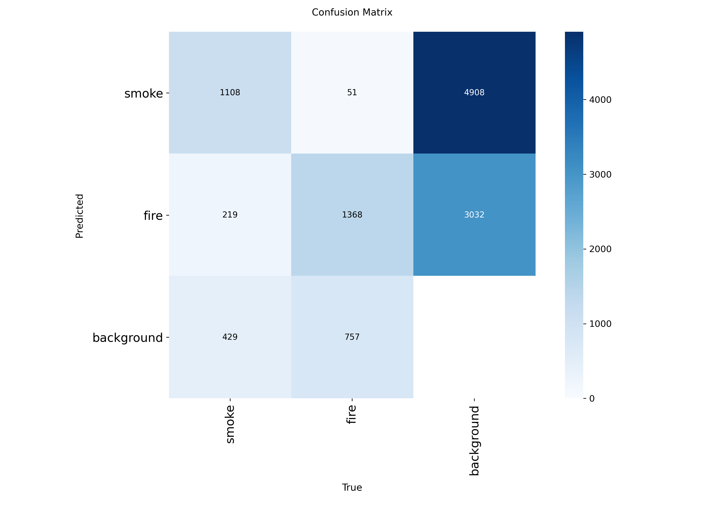

# RT-DETR Fire and Smoke Detection

A coursework project and engineering practice based on Ultralytics RT-DETR-L, with a command-line interface for dataset configuration, training, validation, and image inference. Author: peter24685.

**Current status: two one-epoch pipeline experiments have been completed. The model has not been fully trained or validated in real-world fire safety scenarios.** Contributions cover data and configuration organization, model integration, debugging, and experiment documentation, rather than a new detection algorithm. AI tools assisted with code cleanup; historical metrics come from preserved local run records.

## Features

- Consolidates three scripts with hard-coded paths into a configurable CLI.
- Generates local dataset YAML with the class mapping `0=smoke, 1=fire`.
- Preserves historical training CSV files and distinguishes validation metrics from test results.
- Runs inference on local images or directories and saves annotated outputs.

## Environment and Installation

Locally verified environment: Windows, Python 3.10.20, PyTorch 2.7.1+cu118, and Ultralytics 8.4.55, with CUDA available. Install PyTorch for your hardware using the [official instructions](https://pytorch.org/get-started/locally/), then install the application dependencies. Example for CUDA 11.8:

```powershell
python -m venv .venv
.venv\Scripts\Activate.ps1
python -m pip install torch==2.7.1 torchvision==0.22.1 --index-url https://download.pytorch.org/whl/cu118
python -m pip install -r requirements.txt
python main.py --help
```

Without an NVIDIA GPU, use the PyTorch CPU package index and pass `--device cpu`. These installation commands have not been tested on a clean machine; inference checks used the existing environment described above.

## Dataset Preparation

Available provenance points to [D-Fire](https://github.com/gaia-solutions-on-demand/DFireDataset) and a pre-split distribution. This repository does not redistribute images or annotations. Obtain data through the dataset authors and follow the applicable terms. The exact downloaded archive and original checksums were not retained, so the local dataset should not be treated as a version-pinned public benchmark.

Organize your local dataset as follows:

```text
dataset-root/
  train/images/   train/labels/
  val/images/     val/labels/
  test/images/    test/labels/
```

```powershell
python main.py prepare --root "D:/datasets/fire-smoke"
```

The generated `configs/local.yaml` is excluded from Git. Verify label IDs before using a new dataset; changing class names alone does not correct a label mismatch. The current mapping follows the configuration used for training and has been checked against selected examples, but a complete annotation audit has not been performed.

## Training and Validation

```powershell
# One epoch checks the pipeline; the historical runs also used one epoch, not convergence.
python main.py train --weights rtdetr-l.pt --epochs 1 --device 0 --name baseline

# Use the output directory reported by the CLI; existing run names may be incremented.
python main.py val --weights "runs/baseline/weights/best.pt" --split val --device 0
```

`rtdetr-l.pt` is a general-purpose pretrained checkpoint provided by the framework. Fire and smoke inference requires weights trained on the project dataset. Custom trained weights are not currently distributed with this repository; train your own or use a saved local checkpoint. Select `--split test` explicitly for test evaluation, and do not repeatedly tune against the test set.

## Inference

```powershell
python main.py predict --weights "runs/baseline/weights/best.pt" --source "examples/input.jpg" --device cpu --name demo
```

`examples/input.jpg` is a placeholder, not an included image. Replace it with your own image or image directory. Annotated outputs are saved to the `save_dir` reported by the CLI.

## Historical Results

The following values are taken from the final CSV row of each original training run and describe the **validation set**, not an independent test set. No retraining was performed during repository cleanup. Both runs used one epoch, an input size of 640, and a batch size of 2.

| Run | Precision | Recall | mAP50 | mAP50-95 |
|---|---:|---:|---:|---:|
| test_run-3 | 0.51105 | 0.47722 | 0.43786 | 0.18581 |
| test_run-4 | 0.51555 | 0.45115 | 0.46118 | 0.20082 |

See the [experiment notes](docs/experiments.md) and `reports/` for preserved records. False positives and missed detections remain possible. This model must not be used to make operational fire alarm decisions.



This figure comes from the original training directory. It illustrates class confusion and background errors at that evaluation's threshold, which is not necessarily the threshold used to calculate each metric in the table.

## Checks and Next Steps

```powershell
python -m unittest discover -s tests -v
```

Tests cover dataset directory validation, class ordering, and the default validation split. See the [verification notes](docs/verification.md) for the local inference check.

Next steps: pin the dataset version and splits, audit label semantics, train more thoroughly, analyze false positives and missed detections, and evaluate on a fixed test set. Real-time alarms, video monitoring services, a web interface, and production deployment are not implemented.

## References and License

- [Ultralytics RT-DETR documentation](https://docs.ultralytics.com/models/rtdetr/)
- [Original RT-DETR project](https://github.com/lyuwenyu/RT-DETR)
- [D-Fire dataset](https://github.com/gaia-solutions-on-demand/DFireDataset)
- Project code is licensed under AGPL-3.0; see `LICENSE`. Third-party models, frameworks, and datasets remain subject to their own licenses. This code license does not grant redistribution rights for data or model weights.
